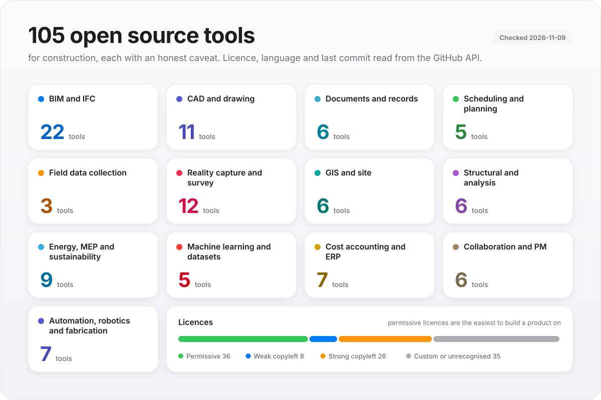

# Open source construction tools

A list of open source software that actually gets used in construction, building and infrastructure work —
and, just as importantly, an honest note on what each one is *not* good for.

Most lists in this space are written by people who have never had to explain a schedule slip. This one is
narrower on purpose: every project here has been checked against the GitHub API for its licence, language,
last commit and archived status, so you can see at a glance whether you are looking at something maintained
or something abandoned in 2019.

<p align="center">
  <picture>
    <source media="(prefers-color-scheme: dark)" srcset="assets/tools-map-dark.svg">
    
  </picture>
</p>

## How to read this list

- **Licence and activity are read from the API, not typed by hand.** Both matter more than star counts. A
  permissive licence (MIT, Apache-2.0, BSD) lets you embed the code in something you sell; a copyleft licence
  (GPL, AGPL) usually does not, without obligations you should read properly. AGPL in particular catches
  people who only plan to offer a hosted service.
- **"Last commit" is the abandonment check.** Anything that has not moved in two years is either finished or
  forgotten, and you should find out which before you build on it.
- **Stars measure attention, not fitness.** A popular library with the wrong licence for your product is
  still the wrong library.
- **The caveat column is the point.** Every tool here is good at something narrower than its README suggests.
- **Nothing here is a recommendation for a specific project.** Validate against your own work, your own data
  and your own contracts.

<!-- begin:index -->
*105 projects checked against the GitHub API on 2026-11-09. Licence, language, last commit and archived status are read from the API, not typed by hand.*

### BIM and IFC

Model authoring, IFC parsing and model servers. The strongest open source area in construction.

| Project | What it does in a construction workflow | Caveat | Licence | Language | Last commit |
| --- | --- | --- | --- | --- | --- |
| [Pascal Editor](https://github.com/pascalorg/editor) | Browser-based 3D architecture editor with scan-to-BIM, an MCP server and a CLI | Created October 2025 and fast-moving: a modelling editor, not a coordination or issue-tracking tool | MIT | TypeScript | 2026-11-09 |
| [IfcOpenShell](https://github.com/IfcOpenShell/IfcOpenShell) | IFC toolkit in C++ and Python, and the home of Bonsai, a Blender-based BIM authoring environment | Scripting knowledge helps a lot; the Blender interface is not a drafting package | LGPL-3.0 | C++ | 2026-11-09 |
| [Dynamo](https://github.com/DynamoDS/Dynamo) | Visual programming for computational design and automation, widely used to script Revit | Most useful alongside Revit, which is not open source; big graphs are hard to review and version | Apache-2.0 | HTML | 2026-11-09 |
| [pyRevit](https://github.com/pyrevitlabs/pyRevit) | Rapid application development environment for Autodesk Revit: write Python tools and add them to the ribbon | Needs Revit; GPL-3.0 carries obligations if you distribute something built on it | GPL-3.0 | Python | 2026-11-09 |
| [BIMserver](https://github.com/opensourceBIM/BIMserver) | Self-hosted IFC model server with revision control and notifications | Java, heavyweight, and the operational effort is real | AGPL-3.0 | Java | 2026-03-13 |
| [web-ifc](https://github.com/ThatOpen/engine_web-ifc) | WebAssembly IFC parser for the browser: geometry and properties at full speed | Parsing only; you bring the interface and the workflows | MPL-2.0 | TypeScript | 2026-11-09 |
| [xeokit SDK](https://github.com/xeokit/xeokit-sdk) | JavaScript toolkit for viewing large BIM and IFC models in the browser with WebGL | AGPL-3.0, so a hosted product has obligations; check whether its commercial licence suits you | AGPL-3.0 | HTML | 2026-11-02 |
| [Speckle](https://github.com/specklesystems/speckle-server) | Open data platform that moves geometry and data between AEC tools | Server to run; check the licence for commercial hosting | custom | TypeScript | 2026-11-06 |
| [iTwin.js](https://github.com/iTwin/itwinjs-core) | Libraries for building viewers and apps on infrastructure digital twins (iModels) | A large framework with its own data model, led by Bentley; expect a learning curve | MIT | TypeScript | 2026-11-09 |
| [ThatOpen Components](https://github.com/ThatOpen/engine_components) | Web components for viewing, measuring and coordinating IFC models in a browser | The successor to IFC.js and still moving; pin your versions | MIT | TypeScript | 2026-11-08 |
| [xBim Essentials](https://github.com/xBimTeam/XbimEssentials) | .NET toolkit for reading, writing and querying IFC | The .NET option; smaller community than IfcOpenShell | custom | C# | 2026-08-28 |
| [DDC cad2data converters](https://github.com/datadrivenconstruction/cad2data-Revit-IFC-DWG) | Converts Revit, IFC and DWG files to open data formats offline, without a CAD licence | Only the workflows and docs are MIT; the converters themselves are under a non-commercial EULA, so commercial use needs the authors' licence | custom | Python | 2026-11-09 |
| [Revit MCP (mcp-servers-for-revit)](https://github.com/mcp-servers-for-revit/revit-mcp) *(archived)* | MCP server that lets AI clients such as Claude read, create, modify and delete elements in Revit | Needs Revit, and its tools can change the model: try it on a copy | MIT | TypeScript | 2026-02-25 |
| [ifc-lite](https://github.com/LTplus-AG/ifc-lite) | Browser-first WebGPU IFC viewer with a TypeScript SDK, CLI and MCP server | Created January 2026; MPL-2.0 requires changes to its own files to be shared | MPL-2.0 | TypeScript | 2026-11-09 |
| [BIMsurfer](https://github.com/opensourceBIM/BIMsurfer) | Browser-based IFC viewer used by BIMserver | A viewer, not a coordination or clash tool | MIT | JavaScript | 2025-12-30 |
| [Hypar Elements](https://github.com/hypar-io/Elements) | Code-first C# library for building models and exporting them as glTF | A library for developers; Hypar's hosted platform is a separate commercial product | MIT | C# | 2026-11-07 |
| [buildingSMART IDS](https://github.com/buildingSMART/IDS) | The Information Delivery Specification: a machine-readable way to say what data a BIM model must contain | A specification and test material, not an application; check your authoring software supports it | custom | C# | 2026-09-25 |
| [xBim Windows UI](https://github.com/xBimTeam/XbimWindowsUI) | Windows desktop IFC viewer, validation and model tools | Desktop .NET heritage; check the release cadence before depending on it | custom | C# | 2026-08-24 |
| [BHoM](https://github.com/BHoM/BHoM) | Object model and toolkits for moving data between engineering and design software | C# based; its value depends on which software adapters you need and whether they are maintained | LGPL-3.0 | C# | 2026-11-03 |
| [xBim WebUI](https://github.com/xBimTeam/XbimWebUI) | Web-based IFC model viewer from the xBim project | Viewer only; lighter maintenance than the desktop stack | custom | TypeScript | 2026-10-24 |
| [Bldrs Share](https://github.com/bldrs-ai/Share) | Browser IFC review and collaboration, with links you can share | Young project; validate against your own models first | AGPL-3.0 | JavaScript | 2026-11-09 |
| [revit-mcp (Constructelligence)](https://github.com/constructelligence-lab/revit-mcp) | MCP server for Revit that is read-only by default, with photoreal renders through Blender and PDF, IFC and glTF export | Needs Revit; maintained by the authors of this list, and its add-in has not yet been run against a live Revit by them | MIT | JavaScript | 2026-11-09 |

### CAD and drawing

Drawing production, and the PDF and OCR plumbing most document workflows end up needing.

| Project | What it does in a construction workflow | Caveat | Licence | Language | Last commit |
| --- | --- | --- | --- | --- | --- |
| [Stirling PDF](https://github.com/Stirling-Tools/Stirling-PDF) | Self-hosted PDF toolbox: merge, split, stamp, OCR, redact, compress | General purpose; it knows nothing about sheets and revisions | custom | TypeScript | 2026-11-09 |
| [PaddleOCR](https://github.com/PaddlePaddle/PaddleOCR) | OCR with strong layout and table understanding | Model downloads and GPU expectations; keep documents in-house | Apache-2.0 | Python | 2026-09-16 |
| [Tesseract](https://github.com/tesseract-ocr/tesseract) | The OCR engine behind most document digitisation | Accuracy collapses on stamped, folded, hand-annotated drawings | Apache-2.0 | C++ | 2026-11-09 |
| [pdf.js](https://github.com/mozilla/pdf.js) | PDF rendering in the browser; the base layer of most web drawing viewers | Rendering and forms, not measurement or markup workflows | Apache-2.0 | JavaScript | 2026-11-09 |
| [FreeCAD](https://github.com/FreeCAD/FreeCAD) | Parametric 3D CAD with BIM, FEM and drawing workbenches | Real learning curve; a modelling tool rather than a construction platform | LGPL-2.1 | C++ | 2026-11-09 |
| [PyMuPDF](https://github.com/pymupdf/PyMuPDF) | Fast PDF parsing, text extraction and manipulation in Python | AGPL for the free tier: check before embedding in a product | AGPL-3.0 | Python | 2026-11-09 |
| [pdfplumber](https://github.com/jsvine/pdfplumber) | Extracts text, tables and coordinates from PDFs | Text-based PDFs only; scanned sets need OCR first | MIT | Python | 2026-10-15 |
| [LibreCAD](https://github.com/LibreCAD/LibreCAD) | 2D CAD for drawing production | 2D only, and DWG support is weaker than DXF: convert first | custom | C++ | 2026-11-09 |
| [Camelot](https://github.com/atlanhq/camelot) *(archived)* | Pulls tables out of PDFs into dataframes | Merged cells and borderless tables defeat it | custom | Python | 2023-01-05 |
| [QCAD](https://github.com/qcad/qcad) | 2D CAD with a mature DXF/DWG engine | Community edition is GPL; some features are paid editions | custom | C++ | 2026-11-08 |
| [ezdxf](https://github.com/mozman/ezdxf) | Python library to read, write and automate DXF drawings | A library, not a CAD interface; excellent for drawing QA scripts | MIT | Python | 2026-11-08 |

### Documents and records

Document management and archives, one step removed from proper EDMS.

| Project | What it does in a construction workflow | Caveat | Licence | Language | Last commit |
| --- | --- | --- | --- | --- | --- |
| [Docling](https://github.com/docling-project/docling) | Converts PDFs, Office files and images into structured text for AI pipelines | Reads documents, not drawings: it does not take quantities off plan sheets, and scans need checking | MIT | Python | 2026-11-09 |
| [Paperless-ngx](https://github.com/paperless-ngx/paperless-ngx) | Scans, indexes and archives documents with tags and full-text search | An archive, not an EDMS: no transmittals, revisions or approval workflow | GPL-3.0 | Python | 2026-11-09 |
| [BookStack](https://github.com/BookStackApp/BookStack) | Wiki-style knowledge base for procedures and O&M documentation | Uncontrolled documentation: not a substitute for a document control system | MIT | PHP | 2026-11-09 |
| [DocuSeal](https://github.com/docusealco/docuseal) | Self-hosted document signing and form filling | AGPL-3.0; e-signing is not document control, and legal acceptance of e-signatures varies by contract and country | AGPL-3.0 | Ruby | 2026-11-09 |
| [open-pdf-studio](https://github.com/OpenAEC-Foundation/open-pdf-studio) | PDF viewer and editor with its own Rust engine | Created January 2026; a viewer and markup tool, not a quantity take-off package | LGPL-3.0 | HTML | 2026-11-09 |
| [Mayan EDMS](https://github.com/mayan-edms/mayan-edms) | Document management with metadata, versioning and workflow | Setup effort is high and the interface shows its age | custom | Python | 2026-05-23 |

### Scheduling and planning

Gantt and CPM tools, plus the optimisation libraries you build a scheduler on.

| Project | What it does in a construction workflow | Caveat | Licence | Language | Last commit |
| --- | --- | --- | --- | --- | --- |
| [OpenProject](https://github.com/opf/openproject) | Project management with Gantt charts, work packages, budgets and costs | Not a CPM engine: no float analysis or claim-grade schedule reporting | GPL-3.0 | Ruby | 2026-11-09 |
| [OR-Tools](https://github.com/google/or-tools) | Google's optimisation toolkit, including CP-SAT for scheduling and sequencing | You supply the model; it is not a scheduling application | Apache-2.0 | C++ | 2026-11-09 |
| [frappe gantt](https://github.com/frappe/gantt) | JavaScript library that draws Gantt charts | A chart, not a scheduler: it has no critical path or resource logic | MIT | JavaScript | 2026-06-18 |
| [GanttProject](https://github.com/bardsoftware/ganttproject) | Desktop Gantt charting and critical path scheduling | Basic resource handling; not scaled to multi-job construction programmes | GPL-3.0 | Java | 2026-11-08 |
| [TaskJuggler](https://github.com/taskjuggler/TaskJuggler) | Text-based project planning with real resource levelling | Batch and syntax-heavy; you edit a plan file rather than a chart | GPL-2.0 | Ruby | 2025-07-28 |

### Field data collection

Forms, inspections and field records on a phone, without a commercial platform.

| Project | What it does in a construction workflow | Caveat | Licence | Language | Last commit |
| --- | --- | --- | --- | --- | --- |
| [ODK Collect](https://github.com/getodk/collect) | Android client for filling in ODK forms offline and syncing later | Android only; iOS needs a replacement in the field | custom | Kotlin | 2026-11-06 |
| [ODK Central](https://github.com/getodk/central) | Self-hosted server for mobile field forms, submissions and exports | Not construction-aware: you design the forms and the workflow | Apache-2.0 | JavaScript | 2026-11-06 |
| [KoboToolbox](https://github.com/kobotoolbox/kpi) | Form builder and data collection platform with a mature offline story | The hosted service is the easy path; self-hosting is real work | AGPL-3.0 | Python | 2026-11-09 |

### Reality capture and survey

Photogrammetry, point clouds and the libraries that process them.

| Project | What it does in a construction workflow | Caveat | Licence | Language | Last commit |
| --- | --- | --- | --- | --- | --- |
| [Open3D](https://github.com/isl-org/Open3D) | Point cloud, mesh and registration algorithms in Python and C++ | A library, not an application; you build the workflow | custom | C++ | 2026-11-05 |
| [COLMAP](https://github.com/colmap/colmap) | Structure-from-motion and multi-view stereo photogrammetry | Research-grade interface; command line heavy | custom | C++ | 2026-11-09 |
| [Meshroom](https://github.com/alicevision/Meshroom) | Photogrammetry with a node-based graphical interface | GPU hungry, and photogrammetry is not measurement-grade surveying | custom | Python | 2026-11-09 |
| [OpenMVG](https://github.com/openMVG/openMVG) | C++ library for multiple view geometry and structure from motion | A library for developers and researchers, not an end-user application | MPL-2.0 | C++ | 2026-11-07 |
| [OpenDroneMap](https://github.com/OpenDroneMap/ODM) | Turns drone imagery into maps, point clouds and 3D models | Needs good overlap and ground control; outputs still need QA against survey | AGPL-3.0 | Python | 2026-10-29 |
| [Potree](https://github.com/potree/potree) | Web viewer for very large point clouds | Display and navigation only | custom | JavaScript | 2026-01-08 |
| [CloudCompare](https://github.com/CloudCompare/CloudCompare) | Inspect, compare, measure and clean point clouds and meshes | Desktop tool with no project database or audit trail | custom | C++ | 2026-11-08 |
| [WebODM](https://github.com/WebODM/WebODM) | Web interface for OpenDroneMap: process drone imagery into maps, point clouds and 3D models | AGPL-3.0, so a hosted service has obligations; processing needs a capable machine | AGPL-3.0 | Python | 2026-11-09 |
| [OpenSfM](https://github.com/mapillary/OpenSfM) | Structure-from-motion pipeline that turns overlapping photos into 3D reconstructions | A library for Python users with no GUI; OpenDroneMap packages it for most site teams | BSD-2-Clause | Python | 2026-11-02 |
| [PDAL](https://github.com/PDAL/PDAL) | Point cloud data abstraction with pipeline processing | Format and pipeline plumbing rather than end user tooling | custom | C++ | 2026-11-09 |
| [OpenReality](https://github.com/reality-opened/openreality) | Turns phone video into 3D scenes an AI client can query, with MCP tools | Created September 2026, so very new: check maturity before relying on it | BSD-2-Clause | Python | 2026-10-30 |
| [laspy](https://github.com/laspy/laspy) | Read and write LAS and LAZ point cloud files in Python | File format plumbing; pair it with something that analyses | custom | Python | 2026-05-30 |

### GIS and site

Site mapping, terrain and coordinate reference systems.

| Project | What it does in a construction workflow | Caveat | Licence | Language | Last commit |
| --- | --- | --- | --- | --- | --- |
| [CesiumJS](https://github.com/CesiumGS/cesium) | JavaScript library for 3D globes and maps, including streamed 3D Tiles | A globe and tiles renderer, not a BIM tool: building models need converting to 3D Tiles first | Apache-2.0 | JavaScript | 2026-11-09 |
| [QGIS](https://github.com/qgis/QGIS) | Desktop GIS used for site mapping, earthwork volumetrics and utility records | Not CAD: plan production and sheet setup are limited | GPL-2.0 | C++ | 2026-11-09 |
| [GDAL](https://github.com/OSGeo/gdal) | The geospatial translation and processing library under almost everything else | Command line and API only; unglamorous and everywhere | custom | C++ | 2026-11-08 |
| [GeoServer](https://github.com/geoserver/geoserver) | Serves map layers over OGC web services to browsers and apps | Java stack with real operational overhead | custom | Java | 2026-11-09 |
| [pyproj](https://github.com/pyproj4/pyproj) | Coordinate reference system transformations in Python | Choosing the wrong CRS is still your problem, silently | MIT | Python | 2026-11-02 |
| [WhiteboxTools](https://github.com/jblindsay/whitebox-tools) | Terrain, hydrology and raster analysis for earthwork and drainage | Terrain analysis focus; not a survey adjustment tool | MIT | Rust | 2026-05-26 |

### Structural and analysis

Section, frame and nonlinear analysis for engineers who script.

| Project | What it does in a construction workflow | Caveat | Licence | Language | Last commit |
| --- | --- | --- | --- | --- | --- |
| [OpenSees](https://github.com/OpenSees/OpenSees) | Nonlinear structural analysis, widely used in earthquake engineering | Research-grade complexity and steeper than a frame tool | custom | C++ | 2026-11-06 |
| [PyNite](https://github.com/JWock82/PyNite) | 3D frame finite element analysis in Python | Frame elements; it is not a design code checker | MIT | Python | 2026-10-31 |
| [sectionproperties](https://github.com/robbievanleeuwen/section-properties) | Cross-section properties, stress and capacity calculations | Sections only, not whole-structure behaviour | MIT | Python | 2026-04-16 |
| [anaStruct](https://github.com/ritchie46/anaStruct) | 2D frame and truss analysis with plotting | Two dimensions only; teaching to practice grade | LGPL-3.0 | Python | 2026-11-06 |
| [COMPAS](https://github.com/compas-dev/compas) | Computational framework for structural geometry, analysis and fabrication | Python, research-flavoured, and its own learning curve | MIT | Python | 2026-11-09 |
| [OpenSeesPy](https://github.com/zhuminjie/OpenSeesPy) | Python interface to OpenSees for scripting analyses | The packaging and docs repository for OpenSeesPy; same complexity as OpenSees | custom | C++ | 2026-10-28 |

### Energy MEP and sustainability

Simulation and assessment engines: energy, daylight, CFD, LCA.

| Project | What it does in a construction workflow | Caveat | Licence | Language | Last commit |
| --- | --- | --- | --- | --- | --- |
| [OpenFOAM](https://github.com/OpenFOAM/OpenFOAM-dev) | CFD for wind, smoke, ventilation and airflow studies | Specialist tooling: meshing, not modelling, is the hard part | custom | C++ | 2026-11-08 |
| [EnergyPlus](https://github.com/NREL/EnergyPlus) | Whole-building energy simulation, the reference engine in the field | Input files are unforgiving; garbage in, garbage out at scale | custom | C++ | 2026-11-09 |
| [CoolProp](https://github.com/CoolProp/CoolProp) | Thermophysical property database for HVAC and refrigeration calculation | A library; the engineering judgement stays with you | MIT | C++ | 2026-11-09 |
| [OpenStudio](https://github.com/NREL/OpenStudio) | SDK and tooling around EnergyPlus for modelling workflows | Version drift between SDK, GUIs and measures is a known pain | custom | C++ | 2026-11-09 |
| [eemeter](https://github.com/openeemeter/eemeter) | Normalises meter data into energy savings figures | Aimed at utility programme evaluation rather than site work | Apache-2.0 | Python | 2026-11-06 |
| [Ladybug](https://github.com/ladybug-tools/ladybug) | Climate, sun, wind and comfort analysis from weather data | Grasshopper-centric in practice | AGPL-3.0 | Python | 2026-11-05 |
| [Radiance](https://github.com/LBNL-ETA/Radiance) | Daylight and lighting simulation | Decades-old interface; script it or use it through Honeybee | none declared | Shell | 2026-10-28 |
| [Honeybee](https://github.com/ladybug-tools/honeybee) | Daylight and energy modelling built on Radiance and EnergyPlus | Needs Grasshopper or Python skill; not a design tool by itself | GPL-3.0 | Python | 2022-12-27 |
| [Brightway](https://github.com/brightway-lca/brightway25) | Python framework for life cycle assessment (Brightway 2.5) | Version churn is real: 2.5 and 2.x are not interchangeable | BSD-3-Clause | Jupyter Notebook | 2025-11-27 |

### Machine learning and datasets

Detection and segmentation tooling, and the datasets that come with it.

| Project | What it does in a construction workflow | Caveat | Licence | Language | Last commit |
| --- | --- | --- | --- | --- | --- |
| [Ultralytics YOLO](https://github.com/ultralytics/ultralytics) | Object detection and segmentation; the usual starting point for PPE and progress detection | You must train on your own site imagery; published models do not transfer for free | AGPL-3.0 | Python | 2026-11-09 |
| [Segment Anything](https://github.com/facebookresearch/segment-anything) | Promptable image segmentation | Check the weights licence for commercial use before building on it | Apache-2.0 | Jupyter Notebook | 2024-09-18 |
| [Detectron2](https://github.com/facebookresearch/detectron2) | Detection and segmentation toolkit from Meta AI | Research maintenance cadence; expect to pin versions | Apache-2.0 | Python | 2026-10-27 |
| [RoadDamageDetector](https://github.com/sekilab/RoadDamageDetector) | Road damage image dataset and detection baselines | One country's roads: treat it as a benchmark, not a trained model for your site | MIT | Jupyter Notebook | 2025-10-23 |
| [DDC Skills for AI Agents](https://github.com/datadrivenconstruction/DDC_Skills_for_AI_Agents_in_Construction) | A large collection of AI agent skills for construction tasks such as BIM analysis, estimating and scheduling | Created January 2026; read each skill before relying on its numbers or rules | MIT | Python | 2026-10-19 |

### Cost accounting and ERP

General ERPs you can shape into job costing, and accounting basics.

| Project | What it does in a construction workflow | Caveat | Licence | Language | Last commit |
| --- | --- | --- | --- | --- | --- |
| [Odoo](https://github.com/odoo/odoo) | ERP with project, timesheet and analytic accounting | Community edition has no construction apps; licensing differs between editions | custom | Python | 2026-11-09 |
| [ERPNext](https://github.com/frappe/erpnext) | Open ERP with projects, timesheets, purchasing and accounting | Not construction-native: no AIA billing, WIP schedule or retainage without customisation | GPL-3.0 | Python | 2026-11-09 |
| [Dolibarr](https://github.com/Dolibarr/dolibarr) | ERP and CRM for small organisations, with invoicing and projects | Job costing is thin for construction | GPL-3.0 | PHP | 2026-11-09 |
| [InvenTree](https://github.com/inventree/InvenTree) | Inventory management for parts, stock and suppliers | Built for parts and stock tracking, not job costing or progress billing | MIT | Python | 2026-11-09 |
| [GnuCash](https://github.com/Gnucash/gnucash) | Double-entry accounting for small businesses | No job costing at construction scale; fine for a tiny outfit only | custom | C | 2026-11-09 |
| [OpenConstructionERP](https://github.com/datadrivenconstruction/OpenConstructionERP) | Construction ERP covering bills of quantities, take-off and cost matching | Created April 2026 with a very large feature claim: test it on your own data first; AGPL-3.0 | AGPL-3.0 | TypeScript | 2026-11-09 |
| [Tryton](https://github.com/tryton/tryton) | Modular ERP with accounting, projects and timesheets | You build the construction layer yourself | none declared | Python | 2026-11-09 |

### Collaboration and PM

Project tracking, wikis, files and chat for the office and the site trailer.

| Project | What it does in a construction workflow | Caveat | Licence | Language | Last commit |
| --- | --- | --- | --- | --- | --- |
| [Plane](https://github.com/makeplane/plane) | Issue and project tracking with cycles and modules | Generic project tooling; no construction workflow built in | AGPL-3.0 | TypeScript | 2026-11-07 |
| [Outline](https://github.com/outline/outline) | Team knowledge base for procedures and standards | A wiki; discipline still decides whether it stays current | custom | TypeScript | 2026-11-09 |
| [Mattermost](https://github.com/mattermost/mattermost) | Self-hosted team chat with file sharing and integrations | Ops burden, and the mobile app matters on site | custom | TypeScript | 2026-11-09 |
| [Nextcloud](https://github.com/nextcloud/server) | Self-hosted file sharing, document collaboration and office integration | File sharing, not document control: no transmittals or revisions | AGPL-3.0 | PHP | 2026-11-09 |
| [Zulip](https://github.com/zulip/zulip) | Threaded team chat, which suits project discussions better than channels | Operational effort to host; adoption is the real risk | Apache-2.0 | Python | 2026-11-09 |
| [Vikunja](https://github.com/go-vikunja/vikunja) | Self-hosted task and project lists | Lightweight by design; no scheduling or costing | AGPL-3.0 | Go | 2026-11-09 |

### Automation robotics and fabrication

Shop automation and robot middleware, where the field robotics work starts.

| Project | What it does in a construction workflow | Caveat | Licence | Language | Last commit |
| --- | --- | --- | --- | --- | --- |
| [Blender MCP](https://github.com/ahujasid/mcp-for-blender) | Community plugin that lets an AI client drive Blender | It can run scripts inside Blender, so keep it to scratch files; not affiliated with the Blender Foundation | MIT | Python | 2026-11-04 |
| [OctoPrint](https://github.com/OctoPrint/OctoPrint) | Web control for 3D printers | Prototyping and small-scale fabrication | AGPL-3.0 | Python | 2026-11-09 |
| [ROS 2](https://github.com/ros2/ros2) | Robot middleware: perception, navigation and control architecture | Robotics engineering, not construction work; the field is hard | none declared | unknown | 2026-11-04 |
| [Navigation2](https://github.com/ros-navigation/navigation2) | Navigation and path planning stack for mobile robots | Assumes a known map and an engineered environment | custom | C++ | 2026-11-06 |
| [grbl](https://github.com/gnea/grbl) | Motion control firmware for CNC machines | Firmware for hobby and small machines | custom | C | 2024-06-12 |
| [LinuxCNC](https://github.com/LinuxCNC/linuxcnc) | Machine control for CNC fabrication equipment | Shop fabrication rather than site work | GPL-2.0 | Python | 2026-11-09 |
| [Universal Gcode Sender](https://github.com/winder/Universal-G-Code-Sender) | Sends G-code to CNC controllers | Shop tooling; not a production control system | GPL-3.0 | Java | 2026-11-09 |

### Standards, schemas and public data

Not software, but you will need them, and they belong in the same bookmarks.

| Resource | What it is | Caveat |
| --- | --- | --- |
| [openLCA](https://www.openlca.org/) | Life cycle assessment software, open source but distributed outside GitHub | Result quality depends on the database you licence, not on the software |
<!-- end:index -->

## What open source does not give you yet

Worth saying plainly, because the gaps are where the commercial software earns its money:

- **No construction-native ERP.** General ERPs can be shaped into job costing, but AIA-style billing, retainage,
  WIP schedules and cost-to-complete discipline are not there out of the box.
- **No credible open source quantity takeoff with pricing.** You can extract quantities from a model, and there
  are good tools for that. Turning quantities into a priced estimate with means, methods and risk is still a
  commercial product or a spreadsheet.
- **No claim-grade CPM.** Gantt tools exist; float analysis, time impact analysis and contemporaneous delay
  records are not open source.
- **No document control.** Archives and wikis are not transmittals, revisions and approval workflows. EDMS
  projects get close and then are not construction-aware.
- **Thin construction-specific analytics.** Reality capture, GIS and ML tooling are strong; the layers that turn
  them into a progress measurement or a productivity read still mostly get written in-house.

That list is also a fair summary of where a small team could contribute something genuinely useful.

## How to evaluate one of these properly

Before you put any of it on a live job, answer these five questions:

1. **Is it somebody's day job?** A project with one maintainer and no employer behind it is a project you are
   now co-maintaining.
2. **What is the licence, and what does it oblige you to do?** Check the licence file itself, not just the
   SPDX badge.
3. **Can you get your data out?** Ask what the export looks like before you put project data in.
4. **What does it cost to run?** A server, a database and a GPU are operational commitments, not downloads.
5. **Who supports it when it breaks on a Friday?** If the answer is "the community", plan for the delay.

## How this list is maintained

```bash
python3 scripts/refresh.py          # re-verify every entry against the GitHub API and rebuild the index
python3 scripts/validate.py         # check the sources file, the index and this README agree
```

`scripts/refresh.py` is the only thing that writes the index block above: it queries the GitHub API for each
project and refuses to invent metadata. Entries that stop answering stay listed, visibly, under
*Not verifiable right now* rather than being quietly deleted. A scheduled workflow re-runs the refresh weekly.

## Contributing

Add a row to `sources/tools.csv` and run the refresh. Rules:

- The project must be **verifiable** — a live repository or a real project page.
- The **caveat is mandatory**. If you cannot say what a tool is bad at, you have not used it.
- **No dead projects** without an honest note, no abandonware dressed as active, no "AI-powered" entries with
  nothing behind them.
- **Construction relevance**, not general software: a task tracker qualifies only if you can point at the
  construction workflow it serves.


## Licence

The list itself is CC BY 4.0 — use it, adapt it, credit it. The projects listed keep their own licences, which
are shown per row and belong to their authors.

<!-- begin:family -->
## More from Constructelligence

Open construction resources from the same team, all maintained alongside this one:

| Repository | What it is |
| --- | --- |
| [AI in construction](https://github.com/constructelligence-lab/ai-in-construction) | A practical guide to AI in construction: what works today, what the data has to look like, the risks, and a 90-day plan. |
| [Construction data migration](https://github.com/constructelligence-lab/construction-data-migration) | A guide and toolkit for moving a contractor between systems, and proving nothing was lost. |
| [Construction project records](https://github.com/constructelligence-lab/construction-project-records) | Open schemas, templates and a checker for RFIs, submittals, change events, daily reports and punch lists. |
| [Construction reference data](https://github.com/constructelligence-lab/construction-data) | Cost codes, units, waste factors, pay units, trade sequence, glossary and metric formulas in CSV. |
| [Construction reference MCP server](https://github.com/constructelligence-lab/construction-mcp) | An offline MCP server that gives AI assistants construction reference data and calculators. |
| [Construction prompts](https://github.com/constructelligence-lab/construction-prompts) | 28 prompts for ChatGPT, Claude and Gemini, from bid go/no-go to notice letters. |
| [Construction agent skills](https://github.com/constructelligence-lab/construction-agent-skills) | 28 installable agent skills for Claude Code and any agent that reads SKILL.md. |
| [Revit MCP server](https://github.com/constructelligence-lab/revit-mcp) | Connect Autodesk Revit to Claude, Cursor and any MCP client: read the model, render photoreal pictures with Blender, export PDF/IFC/glTF. Read-only until you allow writes. |

<!-- end:family -->

---

*Maintained by [Constructelligence](https://constructelligence.co) — building the AI infrastructure for
construction.*
